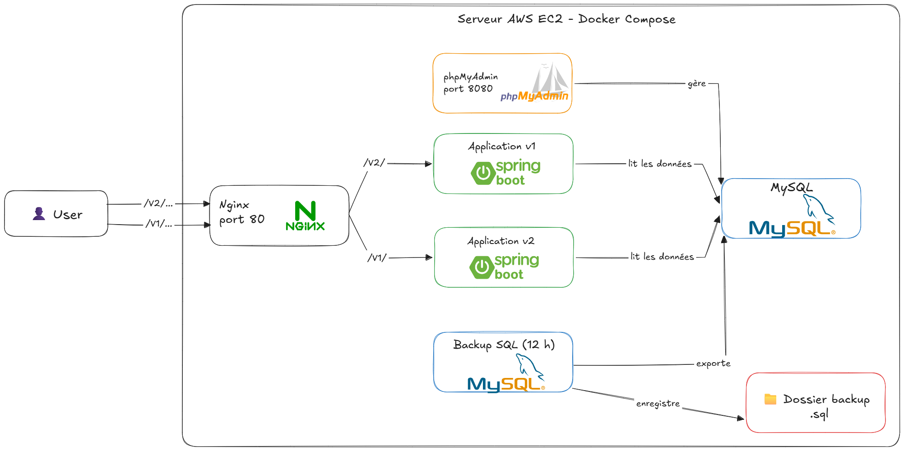
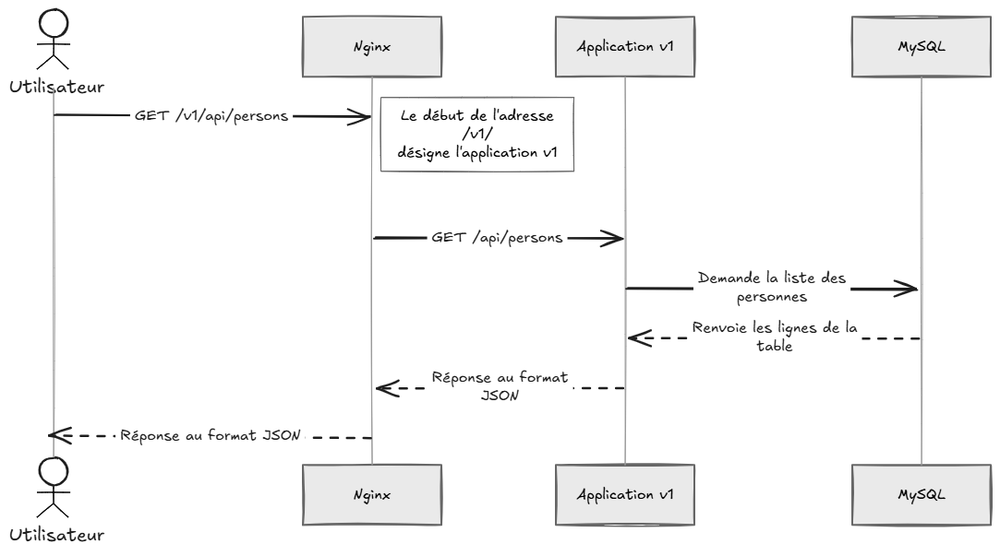
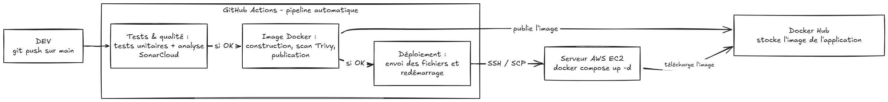

# DevSecOps Pipeline – Spring Boot, Docker & AWS

Application d'annuaire (« **Mon Annuaire Miage** ») exposant une API REST Spring Boot, conteneurisée avec Docker et livrée automatiquement sur AWS EC2 via une chaîne CI/CD GitHub Actions intégrant des contrôles de qualité et de sécurité (SonarCloud, Trivy).

Le projet sert de démonstrateur d'une approche **DevSecOps** de bout en bout : tests automatisés, analyse statique, scan de vulnérabilités de l'image, publication sur Docker Hub, déploiement continu, reverse proxy, sauvegardes de base de données.

## Fonctionnalités

- API REST de consultation d'un annuaire de personnes (`GET /api/persons`).
- Endpoint d'information de version (`GET /api/version`) permettant d'identifier l'instance qui répond.
- Deux instances de l'application (`v1` et `v2`) exposées derrière un reverse proxy **Nginx**.
- Base de données **MySQL** initialisée automatiquement au premier démarrage.
- **Sauvegardes automatiques** de la base toutes les 12 heures.
- Interface d'administration **phpMyAdmin**.
- Pipeline CI/CD complet : tests, qualité, scan de sécurité, publication, déploiement.

## Architecture

Le projet se comprend en **deux parties** : ce qui tourne sur le serveur (l'application et ses services) et le chemin que suit le code pour y arriver (le pipeline CI/CD).

### 1. Vue d'ensemble : ce qui tourne sur le serveur

Tous les services sont des conteneurs Docker lancés ensemble par Docker Compose sur un serveur AWS EC2. Ils communiquent entre eux via un réseau privé (`app-network`). **Nginx (port 80) est la porte d'entrée de l'API ; phpMyAdmin (port 8080) sert uniquement à l'administration.**



 Composant | Rôle en clair |
 --------- | ------------- |
 **Nginx** | Porte d'entrée unique. Il reçoit toutes les requêtes et les redirige vers la bonne instance de l'application selon le début de l'adresse (`/v1/` ou `/v2/`). C'est ce qu'on appelle un *reverse proxy*. |
 **Application v1 / v2** | Deux copies identiques de l'API Spring Boot. Elles ne se distinguent que par leur nom de version, ce qui permet de voir quelle instance répond. |
 **MySQL** | Stocke l'annuaire (table `personnes`). Au premier démarrage, il se remplit automatiquement avec `database/monannuaire_mysql.sql`. |
 **Backup** | Sauvegarde la base toutes les 12 heures dans le dossier `backups/`. |
**phpMyAdmin** | Interface web pour consulter et administrer la base de données. |

### 2. Que se passe-t-il quand on appelle l'API ?

Exemple : un utilisateur demande la liste des personnes via `http://localhost/v1/api/persons`.




1. L'utilisateur envoie sa requête à Nginx, la seule porte d'entrée.
2. Nginx lit le début de l'adresse : `/v1/` désigne l'application v1, `/v2/` l'application v2.
3. Nginx retire ce préfixe et transmet la requête à l'application choisie (`/api/persons`).
4. L'application interroge la base MySQL.
5. MySQL renvoie les données.
6. L'application les met en forme en JSON et les renvoie à Nginx, qui les retransmet à l'utilisateur.

### 3. Du code à la production : le chemin d'un `git push`

À chaque `push` sur la branche `main`, tout est automatisé : plus aucune étape manuelle entre le code et le serveur.



1. **Tests et qualité** : le code est compilé et testé, puis SonarCloud l'analyse (bugs, vulnérabilités, code dupliqué). Si une étape échoue, le pipeline s'arrête ici.
2. **Image Docker** : l'application est empaquetée dans une image, scannée par Trivy à la recherche de failles connues, puis publiée sur Docker Hub.
3. **Déploiement** : GitHub se connecte en SSH au serveur EC2, y envoie les fichiers de configuration, puis demande à Docker Compose de télécharger la nouvelle image et de redémarrer les services.

Le détail de chaque étape est dans la section [Pipeline CI/CD](#pipeline-cicd).

## Stack technique

| Domaine            | Technologies                                              |
| ------------------ | --------------------------------------------------------- |
| Langage / Runtime  | Java 17                                                   |
| Framework          | Spring Boot 3.5 (Web, Data JPA)                           |
| Base de données    | MySQL 5.7 (production), H2 en mémoire (tests)             |
| Build              | Maven 3.9 (Maven Wrapper inclus)                          |
| Conteneurisation   | Docker (build multi-étapes), Docker Compose               |
| Reverse proxy      | Nginx                                                     |
| CI/CD              | GitHub Actions                                            |
| Qualité / Sécurité | SonarCloud, Trivy                                         |
| Hébergement        | AWS EC2, Docker Hub                                       |

## Prérequis

- [Docker](https://docs.docker.com/get-docker/) et Docker Compose v2
- (Développement local) JDK 17 et Maven 3.9+

## Démarrage rapide

### 1. Cloner le dépôt

```bash
git clone https://github.com/OsZa99/devsecops-pipeline-spring-docker.git
cd devsecops-pipeline-spring-docker
```

### 2. Créer le fichier `.env`

```env
DB_NAME=test
DB_USER=root
DB_PASSWORD=un_mot_de_passe
```

> **Important** : `DB_USER` doit valoir `root`. Le conteneur MySQL n'est configuré qu'avec `MYSQL_ROOT_PASSWORD`, aucun autre utilisateur n'est créé automatiquement.
> Le fichier `.env` est ignoré par Git : ne le versionnez jamais.

### 3. (Optionnel) Construire l'image localement

Par défaut, Compose récupère l'image depuis Docker Hub. Pour utiliser votre propre build :

```bash
docker build -t osza/devops-app:latest .
```

### 4. Lancer la stack

```bash
docker compose up -d
```

### 5. Vérifier

```
http://localhost/v1/api/version
http://localhost/v2/api/persons
```

phpMyAdmin est disponible sur <http://localhost:8080>.

Pour arrêter la stack : `docker compose down` (ajoutez `-v` pour supprimer également le volume de données).

## Configuration

Les paramètres sont définis dans `src/main/resources/application.properties` et surchargeables par variables d'environnement.

| Variable                         | Description                                  | Valeur par défaut |
| -------------------------------- | -------------------------------------------- | ----------------- |
| `DB_HOST`                        | Hôte MySQL                                   | `mysql-db`        |
| `DB_NAME`                        | Nom de la base                               | `test`            |
| `DB_USER`                        | Utilisateur MySQL                            | `root`            |
| `DB_PASSWORD`                    | Mot de passe MySQL                           | *(vide)*          |
| `SPRING_DATASOURCE_URL`          | URL JDBC complète (prioritaire si définie)   | –                 |
| `APP_VERSION`                    | Version affichée par `/api/version`          | –                 |
| `APP_USER`                       | Utilisateur affiché par `/api/version`       | –                 |

Notes :

- Le schéma n'est **pas** géré par Hibernate (`ddl-auto=none`) : il est créé à l'initialisation du conteneur MySQL à partir de `database/monannuaire_mysql.sql`.
- Dans `docker-compose.yaml`, `APP_VERSION` et `APP_USER` différencient les instances `v1` et `v2`.

## API

L'application écoute sur le port `10000`. Via Nginx, les routes sont préfixées par `/v1/` ou `/v2/`.

## Pipeline CI/CD

Le workflow [`ci.yml`](.github/workflows/ci.yml) se déclenche à chaque `push` sur la branche `main` et enchaîne trois jobs séquentiels :

| # | Job                                  | Étapes principales                                                                                                                |
| - | ------------------------------------ | --------------------------------------------------------------------------------------------------------------------------------- |
| 1 | **Tests, Sonar & Quality**           | Checkout, installation de Java, `mvn clean verify`, analyse **SonarCloud**, archivage des rapports de tests                       |
| 2 | **Docker Build, Security Scan & Push** | Connexion Docker Hub, build de l'image (tags `latest` et SHA du commit), scan **Trivy** (CRITICAL/HIGH), publication sur Docker Hub |
| 3 | **Deploy to AWS EC2**                | Génération du `.env`, copie des fichiers de déploiement via SCP, `docker compose pull` puis `docker compose up -d` via SSH        |

Chaque image est publiée avec deux tags : `latest` et le SHA du commit, ce qui permet la traçabilité et le rollback.

### Secrets GitHub requis

À configurer dans **Settings → Secrets and variables → Actions** :

| Secret               | Utilisation                                  |
| -------------------- | -------------------------------------------- |
| `SONAR_TOKEN`        | Authentification SonarCloud                  |
| `DOCKERHUB_USERNAME` | Compte Docker Hub                            |
| `DOCKERHUB_TOKEN`    | Token d'accès Docker Hub                     |
| `DB_NAME`            | Nom de la base (généré dans le `.env`)       |
| `DB_USER`            | Utilisateur MySQL (doit valoir `root`)       |
| `DB_PASSWORD`        | Mot de passe MySQL                           |
| `EC2_HOST`           | Adresse de l'instance EC2                    |
| `EC2_USERNAME`       | Utilisateur SSH (ex. `ubuntu`)               |
| `EC2_SSH_KEY`        | Clé privée SSH                               |
| `EC2_SSH_PORT`       | Port SSH                                     |

## Déploiement sur AWS EC2

Prérequis côté serveur :

- Instance EC2 Ubuntu avec **Docker** et le plugin **Docker Compose** installés.
- Port **80** ouvert dans le Security Group (ouvrez `8080` et `3306` uniquement si nécessaire, de préférence restreints à votre IP).
- Accès SSH configuré avec la clé associée au secret `EC2_SSH_KEY`.

Le pipeline dépose les fichiers `docker-compose.yaml`, `nginx.conf`, `database/` et `.env` dans `/home/ubuntu/devops-app`, puis relance les services.

Une fois le pipeline exécuté avec succès, l'application est accessible via l'IP publique du serveur AWS EC2. Vous pouvez tester le routage de Nginx et la communication avec la base de données via ces terminaux d'API :

1. Tester la version 1 de l'API :
http://<Public_IPv4_adress>/v1/api/version

2. Tester la version 2 de l'API (Routage Nginx) :
http://<Public_IPv4_adress>/v2/api/version

3. Interroger la base de données MySQL :
http://<Public_IPv4_adress>/v1/api/persons

(L'interface d'administration de la base de données est accessible sur http://<Public_IPv4_adress>:8080)

## Sauvegarde et restauration

Le service `backup` exécute `mysqldump` **toutes les 12 heures** et écrit les fichiers dans `./backups/` au format :

```
dump-AAAA-MM-JJ-HH-MM.sql
```

## Auteur

Ossama Zarani